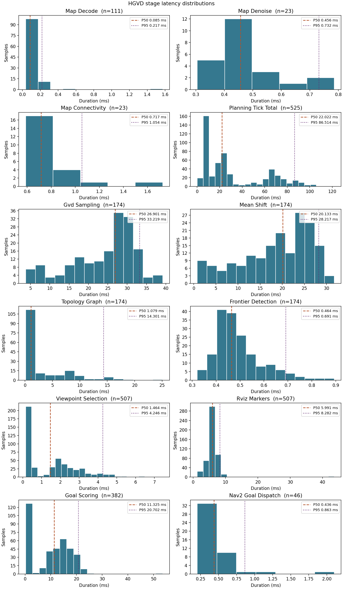
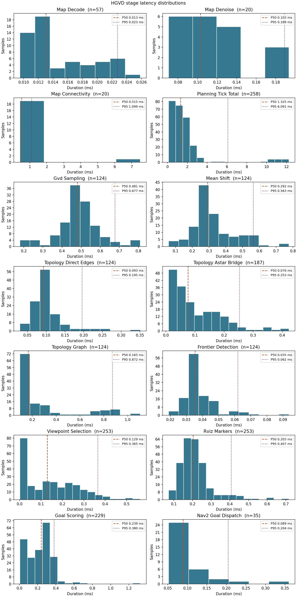

# HGVD Python 与 C++ 阶段耗时对比

2026 年 11 月 24 日保存的两次运行中，**规划轮耗时 P50 从 22.02 ms 降至 1.32 ms，P95 从 86.51 ms 降至 6.09 ms**。按未舍入的 CSV 数据计算，Python 与 C++ 的耗时比为 **16.6 倍（P50）**和 **14.2 倍（P95）**。

两份原始 CSV 和直方图均来自提交 `31d108b` 的 `results/hgvd_timing/`。Python 记录 `20261124_205827` 包含 525 个规划轮，C++ 记录 `cpp_20261124_213955_596687116` 包含 258 个规划轮。两份记录的采样次数不同，也缺少逐轮相同地图、位姿和场景配置的记录。以下数字描述两次历史运行中的**节点阶段延迟**。C++ 版同时改变了距离场复用、近邻查询和评分等实现，无法从这两次运行单独量化语言迁移带来的收益。

## 阶段耗时

P50 是中位数，P95 是 95% 的样本所处的耗时上限。单位为毫秒。每个阶段的样本只包含该阶段实际执行的次数。

| 阶段 | 样本数 Python / C++ | Python P50 | C++ P50 | Python P95 | C++ P95 | P95 耗时比 Python / C++ |
| --- | ---: | ---: | ---: | ---: | ---: | ---: |
| 整个规划轮 | 525 / 258 | 22.022 | 1.325 | 86.514 | 6.091 | 14.2× |
| GVD 采样 | 174 / 124 | 26.901 | 0.481 | 33.219 | 0.677 | 49.0× |
| Mean Shift | 174 / 124 | 20.133 | 0.292 | 28.217 | 0.563 | 50.1× |
| 拓扑构图 | 174 / 124 | 1.079 | 0.165 | 14.301 | 0.872 | 16.4× |
| 候选视点选择 | 507 / 253 | 1.464 | 0.129 | 4.246 | 0.365 | 11.6× |
| 目标评分 | 382 / 229 | 11.325 | 0.239 | 20.702 | 0.380 | 54.5× |
| RViz Marker 生成与发布 | 507 / 253 | 5.991 | 0.203 | 8.282 | 0.407 | 20.3× |
| 地图连通性预处理 | 23 / 20 | 0.717 | 0.515 | 1.054 | 1.099 | 0.96× |

按该规划轮里是否执行了 GVD 采样分组后，**重建轮**的 P95 从 94.85 ms 降至 10.97 ms，**普通轮**从 27.50 ms 降至 1.88 ms。GVD、Mean Shift 和目标评分是这次记录里降幅较大的阶段；地图连通性预处理的 P95 略有上升。C++ 将部分障碍距离场计算放在地图更新阶段，因此阶段边界也有差别。

`planning_tick_total` 已包含该轮中的采样、构图、选点、评分和 Marker 开销，各行耗时不能与它相加。Nav2 目标派发计时仅覆盖异步请求的提交。这些数据没有测量 Nav2 路径执行、整趟探索耗时或覆盖率。

## 原始直方图

**Python** · [原始 CSV](python.csv) · [完整直方图](python.png)



**C++** · [原始 CSV](cpp.csv) · [完整直方图](cpp.png)



## 复测方法

使用 `hgvd-py-cpp` 分支，在 Explorer-2D 根目录构建两个包。先准备 Gazebo、SLAM、Nav2 和 TF，并为两次试验重置到相同地图和位姿。保持规划周期、参数、仿真速度和结束条件一致，分别运行一个版本。下面的命令关闭两者的 Marker 发布，适合测量规划本身。要比较启用可视化的开销，两边使用相同的设置。

```bash
source /opt/ros/humble/setup.bash
colcon build --symlink-install --packages-select hgvd_exploration_ros2 hgvd_exploration_cpp \
  --cmake-args -DCMAKE_BUILD_TYPE=Release
source install/local_setup.bash

# 先运行 Python，停止后重置仿真和 SLAM，再运行 C++
PY_CSV="$PWD/results/hgvd_timing/python_$(date +%Y%m%d_%H%M%S_%N).csv"
ros2 run hgvd_exploration_ros2 hgvd_explorer --ros-args \
  -p use_sim_time:=true -p visualize:=false -p timing_csv:="$PY_CSV"

CPP_CSV="$PWD/results/hgvd_timing/cpp_$(date +%Y%m%d_%H%M%S_%N).csv"
ros2 run hgvd_exploration_cpp hgvd_explorer --ros-args \
  -p use_sim_time:=true -p visualize:=false -p timing_csv:="$CPP_CSV"

# 绘图需要 Python Matplotlib 和 NumPy
python3 src/hgvd-exploration/scripts/plot_timings.py "$PY_CSV"
python3 src/hgvd-exploration/scripts/plot_timings.py "$CPP_CSV"
```

也可以使用 [二维矩阵测试器](../../src/explore_grid_benchmark/README.md) 的 `algorithms:=hgvd,hgvd_cpp`，在同一场景对比覆盖率、路径长度和目标执行结果。
